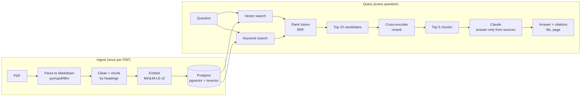

# DocQA: answers from your documents, with page citations

Ask questions about a set of PDFs and get answers that cite the exact file and page, or an honest "I couldn't find that in the documents."

The demo corpus is the paperwork F-1 international students deal with: USCIS Form I-765 instructions, the ICE I-983 training plan, IRS Publications 519 and 901, and university OPT guides.

**Live demo:** https://docqa.fly.dev


## How it works



1. **Ingest:** each PDF is parsed to Markdown page by page, cleaned of formatting noise, and split into chunks along headings and paragraphs. Each chunk is embedded together with its file name and section title, then stored with its page number.
2. **Retrieve:** the question runs through vector search (meaning) and Postgres full-text search (exact terms like "I-765" or "SEVIS"). The two rankings are merged with Reciprocal Rank Fusion into 20 candidates.
3. **Rerank:** a cross-encoder reads the question together with each candidate and rescores how well that chunk answers it. The top 5 go forward.
4. **Answer:** the top chunks go to Claude as numbered sources. The prompt only allows answers from those sources, with inline citations like `[1]`. If the sources don't contain the answer, the bot says so.

## Tech stack

| Layer | Choice |
| --- | --- |
| API | FastAPI (Python 3.12) |
| Database | PostgreSQL + pgvector (Neon in production, Docker locally) |
| Embeddings | `sentence-transformers/all-MiniLM-L6-v2` (384 dims, runs locally, free) |
| Reranker | `cross-encoder/ms-marco-MiniLM-L-6-v2` (local) |
| LLM | Claude (Anthropic API) |
| PDF parsing | pymupdf4llm |
| Hosting | Fly.io (Docker) |
| UI | Plain HTML + fetch, served by FastAPI |

## Evaluation

Every change is measured against a fixed eval set: `evals/questions.jsonl`, with 22 in-scope questions (each tagged with the file and page that answers it) and 10 out-of-scope questions the bot should refuse.

- **hit@5:** was the correct page among the 5 retrieved chunks?
- **Answer accuracy:** an LLM judge compares each answer with the expected answer. I spot-checked its verdicts by hand.

In-scope questions were drafted with Claude from random pages (so the page labels are exact), then reviewed by hand. I rewrote some, deleted trivia, and fixed expected answers.

```bash
python -m evals.run_eval "label-for-this-run"
```

### Results

Only runs on the same question set are comparable.

| Version | hit@5 | Answer accuracy | Kept? |
| --- | --- | --- | --- |
| Better parsing (pymupdf4llm), fixed 800-char chunks | 64% | 69% | Reference |
| + Clean Markdown + heading-aware chunks | 77% | 81% | Yes (+13 / +12) |
| + Hybrid search (vector + keyword, RRF) | 82% | 84% | Yes (+5 / +3) |
| + Cross-encoder reranking | **95%** | **91%** | Yes (+13 / +7) |

**Overall: hit@5 64% → 95%, answer accuracy 69% → 91%.**

**Findings:**

- **Better parsing alone hurt.** On the first question set, hit@5 dropped from 74% to 67%, because Markdown markup (`<mark>`, `**`, table pipes) diluted fixed-size chunks. It only paid off combined with cleaning and heading-aware chunking (+13 points).
- **Hybrid search** added 5 points, mostly on questions with exact identifiers like "I-20" and form numbers.
- **Reranking** was the other big win (+13 points). Small 2-4 page university guides kept losing the top-5 race to similar-but-wrong pages from the long IRS publications. Scoring question and chunk together fixed most of those.
- **Noise:** a run with identical retrieval scored 84% and then 78% accuracy, so the LLM judge varies by about ±2 questions (±6%). Smaller differences aren't treated as real.

## Problems I hit (and fixes)

| Problem | Cause | Fix |
| --- | --- | --- |
| `SSL connection has been closed unexpectedly` in production | Neon suspends idle databases and drops open connections; the app held one global connection | `psycopg_pool.ConnectionPool` with `check_connection`, which tests each connection before use and reconnects |
| `text fields cannot contain NUL (0x00) bytes` | Some PDFs contain invisible NUL characters | Strip `\x00` before inserting |
| `cryptography>=3.1 is required for AES` | IRS/USCIS PDFs are AES-encrypted (open to read, locked for editing) | Add `cryptography` |
| Eval accuracy of 27%; the model said every source was "content" | `retrieve()` switched to dict rows, but `answer()` still unpacked tuples, so iterating a dict yielded its keys | Use `h["content"]` etc. The eval caught a bug that produced no error. |
| `'ThinkingBlock' object has no attribute 'text'` | The response can start with a thinking block | Parse blocks by type, never by position |
| Site unreachable after deploy | No public IP allocated, then proxy port 8080 vs app port 8000 | `fly ips allocate-v4 --shared`, `PORT` env + matching `internal_port` |
| Keyword search returned nothing for natural questions | `plainto_tsquery` ANDs every word | OR the terms (`replace(..., '&', '\|')`) and rank with `ts_rank_cd` |
| Reranking showed no gain at first: hit@5 exactly equal to hybrid search | `retrieve()` was defined twice, and Python silently kept the later, hybrid-only version, so the reranker never ran | Delete the duplicate. The identical hit@5 was the clue. After the fix: 82% → 95% |
| Stale fee in a 2016 university guide conflicted with current USCIS guidance | Documents go out of date | Kept as an eval case: the expected answer notes both the guide's figure and the official fee schedule |

## Design decisions

- **pgvector over a dedicated vector DB:** one database for app data, vectors and keyword search. Fewer moving parts, and HNSW keeps vector search fast at millions of rows.
- **Local embeddings:** free, private (documents never leave the server), fast enough on CPU.
- **Rerank 20 → 5:** the cross-encoder is too slow to score every chunk, but rescoring 20 fused candidates is cheap and fixed most cases where the right page ranked 6th to 20th.
- **Refuse rather than guess:** the system prompt requires citations and an explicit "couldn't find it." For immigration and tax questions, a wrong confident answer is worse than no answer.
- **Hybrid search:** official documents are full of exact identifiers (form numbers, codes like `(c)(3)(B)`) that embeddings blur but keyword search catches.
- **Single container:** FastAPI serves both the API and the static UI, so it deploys as one service on Fly.io.

## Run it locally

```bash
# 1. Postgres with pgvector
docker run -d --name pg -e POSTGRES_PASSWORD=pw -p 5432:5432 pgvector/pgvector:pg17

# 2. Python deps (3.12 recommended)
python -m venv .venv && source .venv/bin/activate
pip install -r requirements.txt

# 3. API key
export ANTHROPIC_API_KEY=sk-ant-...

# 4. Index the PDFs in ./pdfs and start the app
python -m app.ingest_dir pdfs/
uvicorn app.main:app --reload
```

Open http://localhost:8000, or use the API:

```bash
curl -X POST localhost:8000/ask -H "Content-Type: application/json" \
  -d '{"question": "How early can I apply for post-completion OPT?"}'
```

## Deploy (Fly.io + Neon)

```bash
fly secrets set DATABASE_URL="<neon connection string>" ANTHROPIC_API_KEY="sk-ant-..."
fly deploy
DATABASE_URL="<neon connection string>" python -m app.ingest_dir pdfs/   # load documents into production
```

## Project structure

```text
app/
  rag.py          parsing, chunking, retrieval, answering
  main.py         FastAPI routes: /ask, /upload, /health, UI
  ingest_dir.py   index every PDF in a folder
static/index.html UI
evals/
  questions.jsonl eval set
  run_eval.py     hit@5 + LLM-judge accuracy
  make_questions.py  draft questions from random pages
Dockerfile
fly.toml
```

## Disclaimer

DocQA is a portfolio project. Its answers come from the indexed documents, which may be out of date. It is not legal, immigration or tax advice. Confirm anything important with your DSO or an official source.